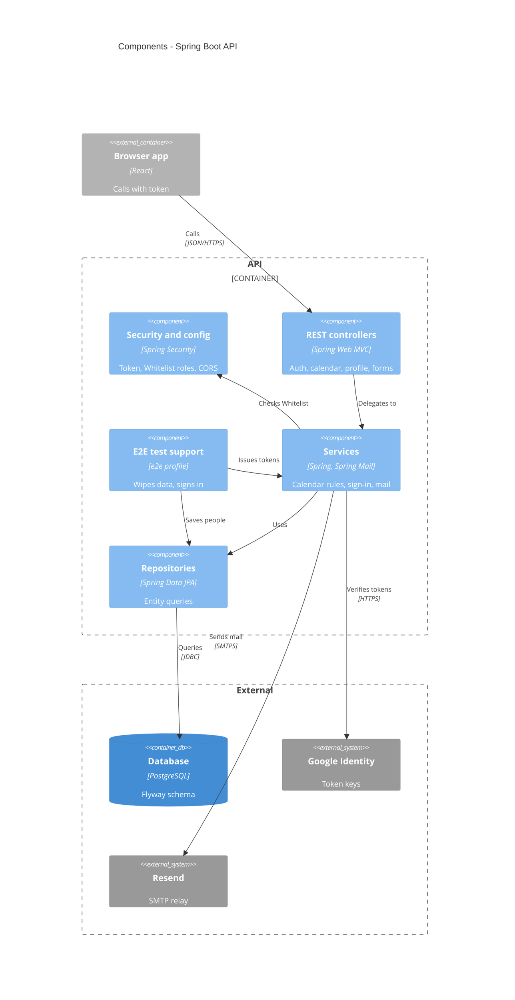

<!-- generated from 20cbc6e7a9d6, 2026-10-28 -->
<!-- c4-map config 77b83c238bd4 -->

# Components: API

Drawn from [docs/c4/level-3.md](../c4/level-3.md). Spring Security (`config`) sits in front of every controller. It checks the API's token and takes the caller's roles from the Whitelist on each request. Controllers hand work to services, and services use the JPA repositories. DTOs, entities and `util` are left out. The E2E test support exists only under the `e2e` profile. Sibling: [web components](c4-components-data.md).

