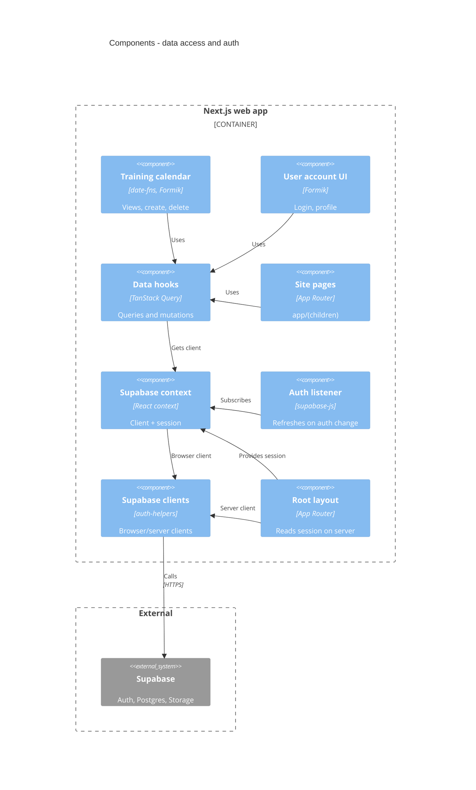

<!-- generated from ac15630618e4, 2026-10-23 -->
<!-- c4-map config 3f246a9f97f3 -->

# Components: data access and auth

Drawn from [docs/c4/level-3.md](../c4/level-3.md). How UI reaches Supabase: components call TanStack Query hooks (`src/hooks`, `hooks/queries`, `hooks/mutations`, merged here), which take the browser client from the Supabase context. Sibling: [forms and email](c4-components-forms-email.md).

