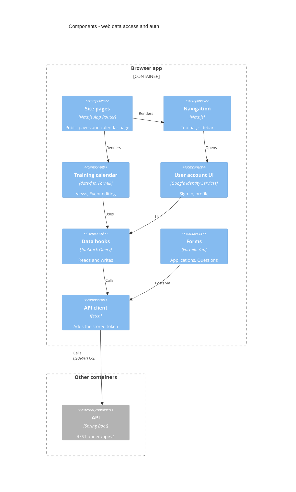

<!-- generated from 20cbc6e7a9d6, 2026-10-28 -->
<!-- c4-map config 77b83c238bd4 -->

# Components: web data access and auth

Drawn from [docs/c4/level-3.md](../c4/level-3.md). How the web app reaches the API. Pages and UI components call TanStack Query hooks (`src/hooks`, `hooks/queries` and `hooks/mutations` are merged here). The hooks, and the forms directly, go through the API client in `src/lib/api.ts`, which adds the stored token. Barrel modules (`components/index`, `components/elements`) are left out and their edges drawn straight through. Sibling: [API components](c4-components-api.md).

