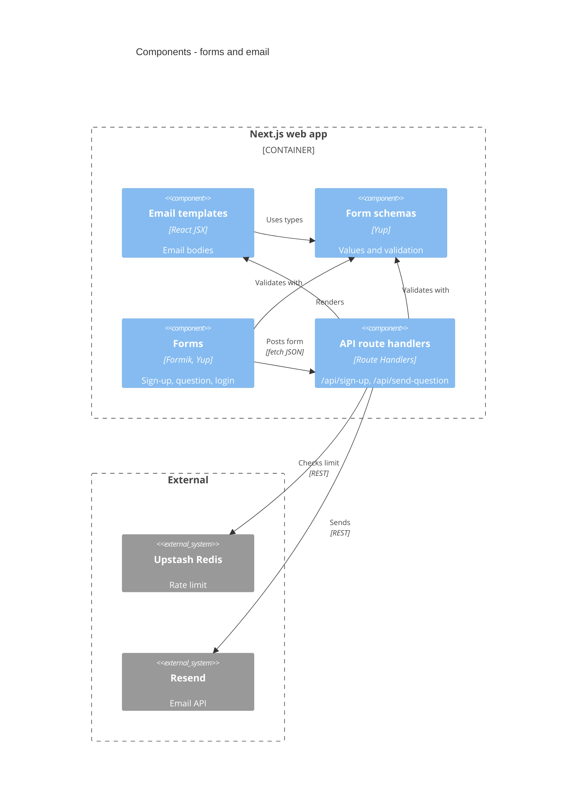

<!-- generated from ac15630618e4, 2026-10-23 -->
<!-- c4-map config 3f246a9f97f3 -->

# Components: forms and email

Drawn from [docs/c4/level-3.md](../c4/level-3.md). Sign-up and question forms post JSON to Route Handlers, which validate with the shared Yup schemas, rate-limit and email the club. The form-to-handler arrow is an HTTP `fetch`, not an import. Sibling: [data access and auth](c4-components-data.md).

