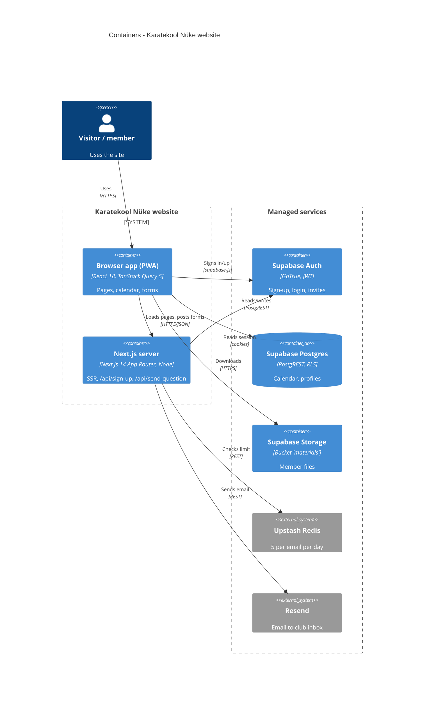

<!-- generated from ac15630618e4, 2026-10-23 -->
<!-- c4-map config 3f246a9f97f3 -->

# Containers: Karatekool Nüke website

Drawn from [docs/c4/level-2.md](../c4/level-2.md). One Next.js 14.0.3 app: the browser part talks to Supabase directly with the anon key and the user's JWT (authorization rests on Supabase RLS); the server part renders pages and handles the two email form endpoints. YouTube/Maps iframes are left out. See also [context](c4-context.md), [components](README.md).

