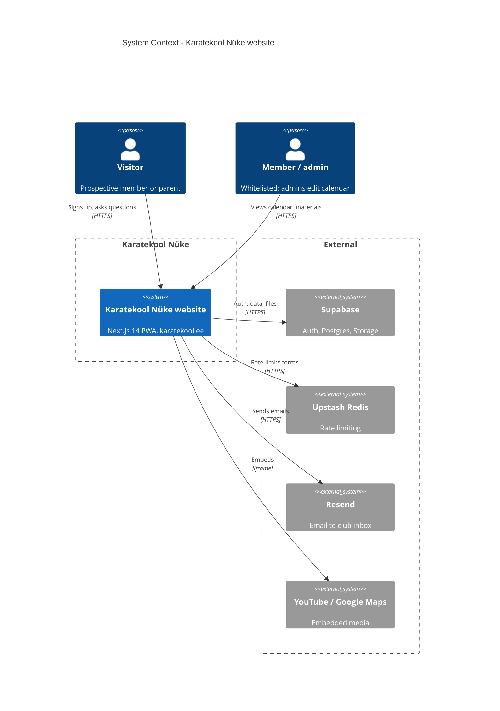

<!-- generated from ac15630618e4, 2026-10-23 -->
<!-- c4-map config 3f246a9f97f3 -->

# System Context: Karatekool Nüke website

Drawn from [docs/c4/level-1.md](../c4/level-1.md). The club's public website with a members-only area. Members and admins share one box: an admin is a member whose `profile.role` is `admin` and who can edit calendar events. Resend delivers sign-up applications and questions to the club inbox (info@karatekool.ee). Fonts are fetched from Google Fonts at build time only and are left out. See also [containers](c4-containers.md).

