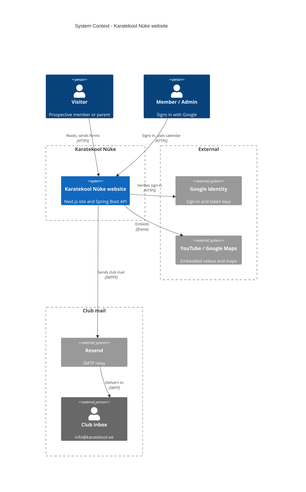

<!-- generated from 20cbc6e7a9d6, 2026-10-28 -->
<!-- c4-map config 77b83c238bd4 -->

# System Context: Karatekool Nüke website

Drawn from [docs/c4/level-1.md](../c4/level-1.md). The club's public website and its own API. Members and Admins share one box: both sign in with Google, and an Admin is a Member marked as one on the Whitelist who can manage the calendar. Resend delivers Applications and Questions to the club inbox (info@karatekool.ee). Fonts come from Google Fonts at build time only and are left out. See also [containers](c4-containers.md).

