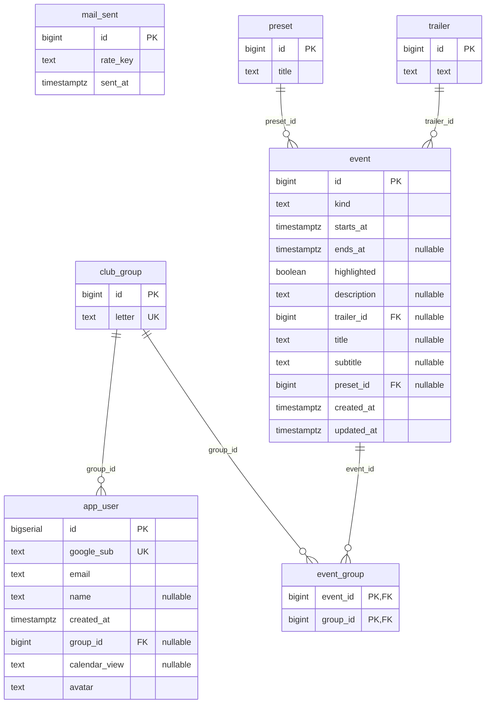

<!-- generated from 20cbc6e7a9d6, 2026-10-28 -->
<!-- c4-map config 77b83c238bd4 -->

> **Agent context map.** Dense on purpose and not laid out for viewing; labels may overlap when rendered. Diagrams for people: [docs/architecture/](../architecture/).

# Database schema

Generated from 4 SQL migrations in `api/src/main/resources/db/migration` (latest: `V4__mail_sent.sql`). Columns only: no defaults or checks. PK primary key, FK foreign key, UK unique.

