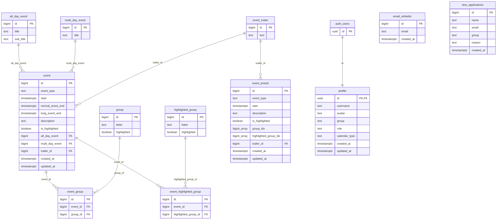

<!-- generated from ac15630618e4, 2026-10-23 -->
<!-- c4-map config 3f246a9f97f3 -->

> **Agent context map.** Dense on purpose and not laid out for viewing; labels may overlap when rendered. Diagrams for people: [docs/architecture/](../architecture/).

# Database: Supabase Postgres (public schema)

No SQL migrations are versioned in this repo. Written by hand from the generated types in `src/types/supabase.ts` (`yarn supabase:types`); RLS policies, triggers and the whitelist check are not visible from here. `profile.id` references `auth.users.id`.

- Column SQL types are inferred from TS types (`number` -> bigint, `string` timestamps -> timestamptz); exact types are not in the repo.
- Functions (custom claims helpers): `get_claim`, `get_claims`, `get_my_claim`, `get_my_claims`, `set_claim`, `delete_claim`, `is_claims_admin`. The app does not call them.
- `new_applications` is not referenced by app code. Storage bucket `materials` holds member files.
