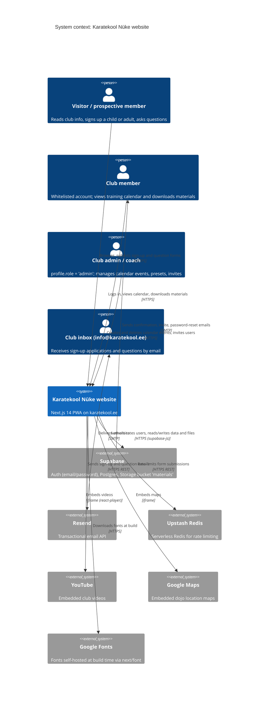

<!-- generated from ac15630618e4, 2026-10-23 -->
<!-- c4-map config 3f246a9f97f3 -->

> **Agent context map.** Dense on purpose and not laid out for viewing; labels may overlap when rendered. Diagrams for people: [docs/architecture/](../architecture/).

# Level 1: System context

Karatekool Nüke website (karatekool.ee): a public Estonian-language site for a karate club, with a members-only area (training calendar, study materials) and email-based sign-up and question forms. Sources: `package.json`, `.env.example`, `src/app/sitemap.ts`, `src/app/api/*/route.ts`.

- Sign-up to the members area is gated by `email_whitelist`: Supabase rejects `auth.signUp` for non-whitelisted emails (error handling in `src/hooks/mutations/user/useSignUp.tsx`; the DB trigger itself is not in the repo).
- "Admin" is a `profile.role` value checked in the UI (`src/components/elements/calendar/`); server-side enforcement must live in Supabase RLS, which is not in the repo.
- Hosting target is not declared in the repo (no Vercel/Docker config); README is the Next.js template mentioning Vercel and `.vercel` is gitignored.
