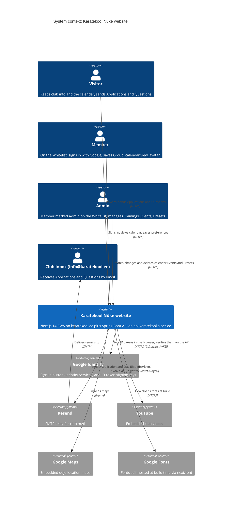

<!-- generated from 20cbc6e7a9d6, 2026-10-28 -->
<!-- c4-map config 77b83c238bd4 -->

> **Agent context map.** Dense on purpose and not laid out for viewing; labels may overlap when rendered. Diagrams for people: [docs/architecture/](../architecture/).

# Level 1: System context

Karatekool Nüke website (karatekool.ee): a public Estonian-language site for a karate club with a training calendar, Application and Question forms, and Google sign-in for Members and Admins. Its data, sign-in and mail go through the club's own Spring Boot API. Sources: `package.json`, `api/pom.xml`, `api/src/main/resources/application.yaml`, `api/src/main/resources/whitelist.yaml`, `src/app/sitemap.ts`.

- Who may sign in, and who is an Admin, is the Whitelist in `api/src/main/resources/whitelist.yaml`, read on every request; changes take effect on the next API deploy (#39 plans an Admin page instead).
- Hosted Supabase (project `wqdplpmiyvwmetnipmwd`) still holds the production data until it is moved to the API's database; this branch no longer talks to it. `supabase/migrations/` keeps its schema for that move.
- The website's hosting target is not declared in the repo; the API deploys to a VPS (see level 2).
