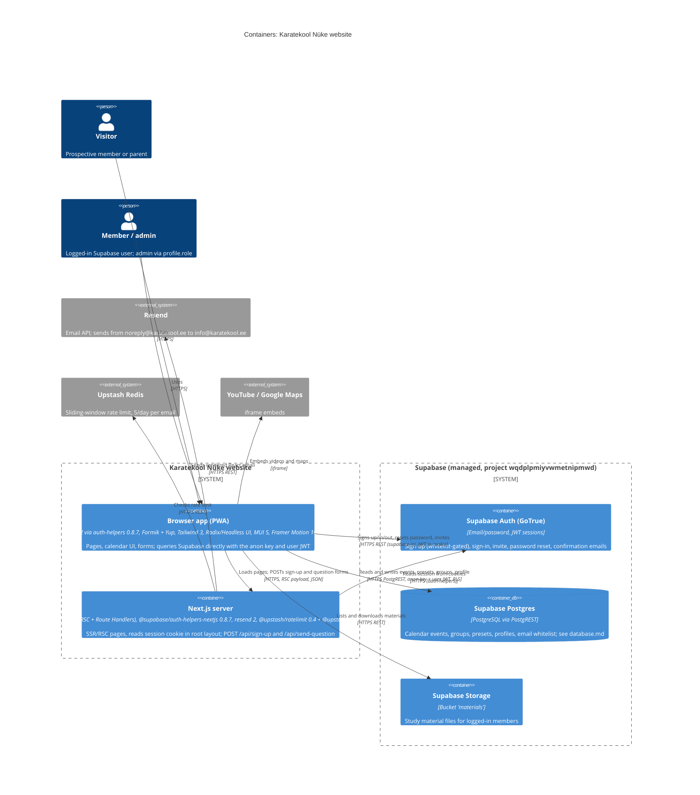

<!-- generated from ac15630618e4, 2026-10-23 -->
<!-- c4-map config 3f246a9f97f3 -->

> **Agent context map.** Dense on purpose and not laid out for viewing; labels may overlap when rendered. Diagrams for people: [docs/architecture/](../architecture/).

# Level 2: Containers

One Next.js 14.0.3 application (App Router, React 18.2, TypeScript 5.3) is the only deployable code; it ships a browser SPA/PWA and server-side Route Handlers. All persistence is Supabase (managed); email and rate limiting are SaaS APIs. There is no custom backend, no Docker, and no IaC. Sources: `package.json`, `next.config.js`, `.env.example`, `.github/workflows/ci.yml`, `src/lib/supabase*.ts`, `src/app/api/*/route.ts`, `src/app/layout.tsx`.

- **No API layer in front of the data**: all reads/writes of calendar data, profiles and materials go browser -> Supabase directly (`src/hooks/queries`, `src/hooks/mutations`, `src/app/(children)/materjalid/page.tsx`) with the public anon key. Authorization therefore rests entirely on Supabase RLS and DB triggers, which are not versioned in this repo. Admin checks in the UI (`user?.role === "admin"`) are cosmetic.
- **Auth flow**: `@supabase/auth-helpers-nextjs` 0.8.7 (deprecated in favour of `@supabase/ssr`) stores the session in cookies. `src/app/layout.tsx` creates a server client and calls `auth.getSession()`, passes the session to `SupabaseProvider` (`src/context/SupabaseContext.tsx`); `SupabaseListener` calls `router.refresh()` when the client token diverges. There is no `middleware.ts`, so tokens are not refreshed server-side.
- **Route Handlers** (`src/app/api/sign-up/route.ts`, `src/app/api/send-question/route.ts`): validate with Yup (`src/app-constants/yupSchemas.ts`), rate-limit via Upstash (`UPSTASH_REDIS_REST_URL/TOKEN`), send via Resend. They do not touch Supabase; sign-up applications go only to email. `src/app/api/hello.ts` is a Pages-Router-style handler and is not a route in the App Router.
- **Secrets**: `NEXT_PUBLIC_RESEND_API_KEY` is used server-side only but its `NEXT_PUBLIC_` prefix inlines it into client bundles if referenced there. `useSendInviteEmail` calls `supabase.auth.admin.inviteUserByEmail` from the browser, which needs a service-role key the browser client does not have.
- **Build/CI**: Yarn (`yarn.lock`); `.github/workflows/ci.yml` runs install, `tsc --noEmit` and ESLint on push/PR, no build, tests or deploy. `next.config.js` ignores TS and ESLint errors during build and adds next-pwa, bundle analyzer, GLSL/audio/pdf.worker loaders. Supabase DB types are generated with `yarn supabase:types` (Supabase CLI 1.113) into `src/types/supabase.ts`.
- **Deployment**: not declared in the repo (no Vercel, Docker or infra config). Production domain `https://karatekool.ee` (`src/app/sitemap.ts`).
