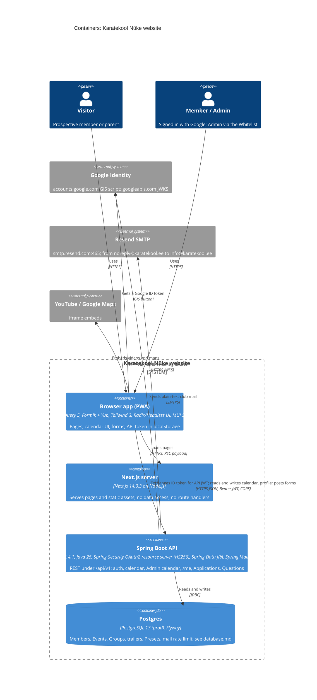

<!-- generated from 20cbc6e7a9d6, 2026-10-28 -->
<!-- c4-map config 77b83c238bd4 -->

> **Agent context map.** Dense on purpose and not laid out for viewing; labels may overlap when rendered. Diagrams for people: [docs/architecture/](../architecture/).

# Level 2: Containers

The browser app (Next.js 14.0.3, App Router, React 18.2) calls a Spring Boot 4 API (Java 25) for everything: calendar data, Member preferences, sign-in and club mail. The API owns a Postgres database migrated by Flyway. Sources: `package.json`, `next.config.js`, `src/lib/api.ts`, `api/pom.xml`, `api/src/main/resources/application*.yaml`, `api/Dockerfile`, `docker-compose.prod.yml`, `.github/workflows/*.yml`, `playwright.config.ts`.

- **Auth**: `POST /auth/google {idToken}` verifies the Google ID token (issuer, audience in `GOOGLE_CLIENT_IDS`, verified email) and returns the API's own 30-day HS256 JWT (`JWT_SECRET`). Roles are not in the token: `SecurityConfig` looks the email up in the Whitelist on every request, so removing someone takes effect at once. Public: `GET /events, /groups, /trailers, /presets` and the three form endpoints; Admin only: calendar writes; everything else needs a Member.
- **Mail**: Applications and Questions are rate-limited to 5 per kind per sender email per 24 h in the `mail_sent` table, then sent over SMTP (`RESEND_API_KEY` as password). The mail health check is off so an SMTP outage does not mark the API down.
- **Frontend config**: `NEXT_PUBLIC_API_URL` (default `http://localhost:8080/api/v1`) and `NEXT_PUBLIC_GOOGLE_CLIENT_ID`; without a client ID, development shows a dev sign-in button that the API's `dev` profile accepts. API config: `CORS_ALLOWED_ORIGINS`, `GOOGLE_CLIENT_IDS`, `JWT_SECRET`, `RESEND_API_KEY`, datasource variables.
- **API deploy** (`.github/workflows/deploy-api.yml`): on push to `main` touching `api/**`, builds `api/Dockerfile`, pushes to Docker Hub, copies `docker-compose.prod.yml` to the VPS (`/my-apps/karatekool`) and runs `postgres:17` plus the API behind Traefik with Let's Encrypt at `api.karatekool.alber.ee`. `verify-api.yml` runs `./mvnw verify` (Testcontainers) on PRs touching `api/**`.
- **Profiles**: `dev` (any token signs in as `dev@karatekool.app`, an Admin; mail to Mailpit) and `e2e` (adds `/test-support` endpoints that wipe the DB; mail to Mailpit). Locally Spring's Docker Compose support starts `api/compose.yaml` (Postgres on 5433).
- **CI for the site**: `ci.yml` runs `tsc` and ESLint; `e2e.yml` sets up Java, starts Mailpit (`e2e/docker-compose.yml`) and runs Playwright, which starts the API with the `e2e` profile and builds the site. `next.config.js` ignores TS and ESLint errors during build.
