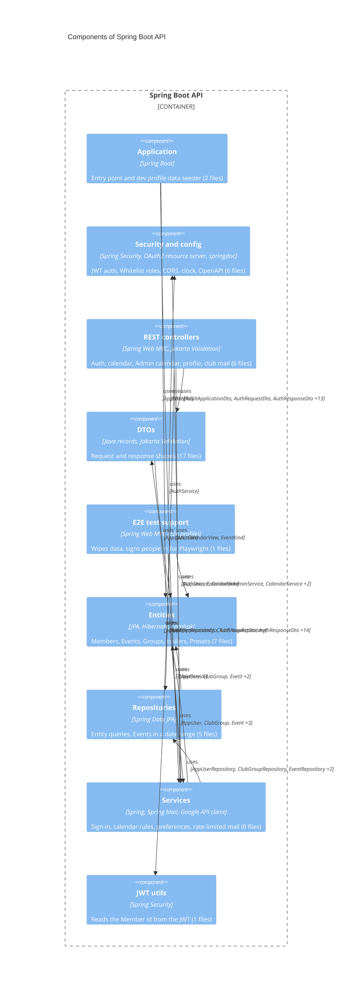

<!-- generated from 20cbc6e7a9d6, 2026-10-28 -->
<!-- c4-map config 77b83c238bd4 -->

> **Agent context map.** Dense on purpose and not laid out for viewing; labels may overlap when rendered. Diagrams for people: [docs/architecture/](../architecture/).

# Level 3: Components

Generated from source imports. A component is a directory (or package) at the configured depth; an arrow means code in one component imports the other, labelled with what it imports. Container context: [level-2.md](level-2.md).

## Next.js web app

Root `src`, depth 2.

```mermaid
C4Component
  title Components of Next.js web app

  Container_Boundary(web_b, "Next.js web app") {
    Component(web__root, "Module declarations", "TypeScript", "Ambient asset module type declarations (1 files)")
    Component(web_app, "Root layout and home", "Next.js App Router, React Query", "Root layout, providers, sitemap, robots (6 files)")
    Component(web_app_constants, "Form schemas", "Yup", "Form values, validation schemas, constants (3 files)")
    Component(web_app__children, "Site pages", "Next.js App Router, Headless UI", "Public pages, calendar, forms, Google login page (29 files)")
    Component(web_app__home_components, "Home page sections", "Next.js", "Landing page sections and hero images (1 files)")
    Component(web_components, "Component barrel", "TypeScript", "Re-exports shared UI components (1 files)")
    Component(web_components_animations, "Animations", "Framer Motion", "Shared animation wrapper and variants (3 files)")
    Component(web_components_elements, "UI primitives", "Radix UI, Headless UI", "Modal, popover, tooltip, toggle, checkbox (9 files)")
    Component(web_components_elements_accordion, "Accordion", "Framer Motion", "Animated accordion with content lists (3 files)")
    Component(web_components_elements_button, "Buttons", "class-variance-authority", "Styled button variants (5 files)")
    Component(web_components_elements_calendar, "Training calendar", "date-fns, Formik", "Month/week/day views, event creation, deletion (46 files)")
    Component(web_components_elements_forms, "Forms", "Formik, Yup", "Application and question forms posting to API (8 files)")
    Component(web_components_elements_home_page, "Home scrollers", "Framer Motion", "Scroll-driven home page sections (1 files)")
    Component(web_components_elements_moving_box, "Moving box", "Framer Motion", "Animated decorative box (2 files)")
    Component(web_components_elements_navigation, "Navigation", "Next.js, Framer Motion", "Top navbar, flyout menu, footer, sidebar links (10 files)")
    Component(web_components_elements_sidebar, "Mobile sidebar", "Framer Motion", "Slide-out mobile navigation (1 files)")
    Component(web_components_elements_user, "User account UI", "Google Identity Services, Formik", "Google sign-in, profile view and edit (5 files)")
    Component(web_components_icons, "Icons", "lucide-react", "Icon set and wave background (3 files)")
    Component(web_config, "Site config", "Next.js", "Routes, navigation and site constants (2 files)")
    Component(web_context, "Context barrel", "React context", "Re-exports sidebar and calendar filter contexts (1 files)")
    Component(web_context_calendar_filters, "Calendar filters", "React context", "Calendar group filter state (2 files)")
    Component(web_context_sidebar, "Sidebar state", "React context", "Mobile sidebar open state (2 files)")
    Component(web_hooks, "UI hooks", "framer-motion, react-intersection-observer", "Scroll, viewport and mobile detection hooks (4 files)")
    Component(web_hooks_mutations, "Data mutations", "TanStack Query", "Calendar, Preset, sign-in and profile writes via API (13 files)")
    Component(web_hooks_queries, "Data queries", "TanStack Query", "Events, Groups, Presets, trailers, Member reads via API (9 files)")
    Component(web_lib, "API client and utils", "fetch, tailwind-merge", "API calls with the stored token, class utils (4 files)")
    Component(web_three, "3D barrel", "TypeScript", "Re-exports 3D components (1 files)")
    Component(web_three_Shader, "Shader", "React Three Fiber, GLSL", "Custom GLSL shader material (1 files)")
    Component(web_three_components, "3D canvas", "React Three Fiber, drei", "Shared canvas layout and 3D views (6 files)")
    Component(web_three_helpers, "3D portal", "tunnel-rat", "Tunnels 3D content into shared canvas (1 files)")
    Component(web_types, "Types", "TypeScript", "Event and app types for components (3 files)")
  }

  Rel(web_app, web__root, "uses", "index")
  Rel(web_app, web_app__home_components, "uses", "app/(home_components)/HomepageComponents")
  Rel(web_app, web_context, "uses", "context/index")
  Rel(web_app, web_lib, "uses", "lib/index")
  Rel(web_app, web_three_components, "uses", "three/components/Three3DLayout")
  Rel(web_app, web_types, "uses", "types/index")
  Rel(web_app__children, web_components, "uses", "components/index")
  Rel(web_app__children, web_components_elements, "uses", "components/elements/LetterDecryptor, components/elements/LoadingSpinner")
  Rel(web_app__children, web_components_elements_navigation, "uses", "components/elements/navigation/EmailSender, components/elements/navigation/Footer, components/elements/navigation/NavbarTop")
  Rel(web_app__children, web_components_elements_sidebar, "uses", "components/elements/sidebar/Sidebar")
  Rel(web_app__children, web_components_icons, "uses", "components/icons/Icons")
  Rel(web_app__children, web_config, "uses", "config/index")
  Rel(web_app__children, web_hooks, "uses", "hooks/index")
  Rel(web_app__children, web_lib, "uses", "lib/index")
  Rel(web_app__children, web_three, "uses", "three/index")
  Rel(web_app__children, web_types, "uses", "types/index")
  Rel(web_app__home_components, web_components, "uses", "components/index")
  Rel(web_app__home_components, web_components_animations, "uses", "components/animations/AnimationWrapper")
  Rel(web_app__home_components, web_components_elements, "uses", "components/elements/LetterDecryptor")
  Rel(web_app__home_components, web_components_elements_home_page, "uses", "components/elements/home-page/Scrollers")
  Rel(web_app__home_components, web_components_elements_navigation, "uses", "components/elements/navigation/EmailSender, components/elements/navigation/Footer, components/elements/navigation/NavbarTop")
  Rel(web_app__home_components, web_components_elements_sidebar, "uses", "components/elements/sidebar/Sidebar")
  Rel(web_app__home_components, web_config, "uses", "config/index")
  Rel(web_app__home_components, web_hooks, "uses", "hooks/index")
  Rel(web_app__home_components, web_lib, "uses", "lib/index")
  Rel(web_components, web_components_animations, "uses", "components/animations/index")
  Rel(web_components, web_components_elements, "uses", "components/elements/index")
  Rel(web_components, web_components_icons, "uses", "components/icons/index")
  Rel(web_components_animations, web_context, "uses", "context/index")
  Rel(web_components_animations, web_hooks, "uses", "hooks/index")
  Rel(web_components_elements, web_app_constants, "uses", "app-constants/index")
  Rel(web_components_elements, web_components, "uses", "components/index")
  Rel(web_components_elements, web_components_elements_accordion, "uses", "components/elements/accordion/index")
  Rel(web_components_elements, web_components_elements_button, "uses", "components/elements/button/index")
  Rel(web_components_elements, web_components_elements_calendar, "uses", "components/elements/calendar/index")
  Rel(web_components_elements, web_components_elements_forms, "uses", "components/elements/forms/index")
  Rel(web_components_elements, web_components_elements_moving_box, "uses", "components/elements/moving-box/index")
  Rel(web_components_elements, web_components_elements_user, "uses", "components/elements/user/index")
  Rel(web_components_elements, web_lib, "uses", "lib/index, lib/utils")
  Rel(web_components_elements_accordion, web_components_elements, "uses", "components/elements/LetterDecryptor")
  Rel(web_components_elements_accordion, web_lib, "uses", "lib/index")
  Rel(web_components_elements_button, web_components, "uses", "components/index")
  Rel(web_components_elements_button, web_lib, "uses", "lib/index, lib/utils")
  Rel(web_components_elements_calendar, web_app_constants, "uses", "app-constants/index")
  Rel(web_components_elements_calendar, web_components, "uses", "components/index")
  Rel(web_components_elements_calendar, web_components_elements, "uses", "components/elements/LetterDecryptor, components/elements/Popover, components/elements/Tooltip")
  Rel(web_components_elements_calendar, web_components_elements_button, "uses", "components/elements/button/index")
  Rel(web_components_elements_calendar, web_components_elements_forms, "uses", "components/elements/forms/index")
  Rel(web_components_elements_calendar, web_components_icons, "uses", "components/icons/Icons")
  Rel(web_components_elements_calendar, web_context, "uses", "context/index")
  Rel(web_components_elements_calendar, web_hooks, "uses", "hooks/index")
  Rel(web_components_elements_calendar, web_lib, "uses", "lib/index, lib/utils")
  Rel(web_components_elements_calendar, web_types, "uses", "types/index")
  Rel(web_components_elements_forms, web_app_constants, "uses", "app-constants/index")
  Rel(web_components_elements_forms, web_components, "uses", "components/index")
  Rel(web_components_elements_forms, web_components_elements, "uses", "components/elements/LoadingSpinner")
  Rel(web_components_elements_forms, web_lib, "uses", "lib/index")
  Rel(web_components_elements_forms, web_types, "uses", "types/index")
  Rel(web_components_elements_home_page, web_components_animations, "uses", "components/animations/index")
  Rel(web_components_elements_home_page, web_hooks, "uses", "hooks/index")
  Rel(web_components_elements_home_page, web_lib, "uses", "lib/index")
  Rel(web_components_elements_navigation, web_components, "uses", "components/index")
  Rel(web_components_elements_navigation, web_components_elements, "uses", "components/elements/LoadingSpinner")
  Rel(web_components_elements_navigation, web_components_elements_user, "uses", "components/elements/user/LoginModal, components/elements/user/UpdateProfile, components/elements/user/UserProfile")
  Rel(web_components_elements_navigation, web_components_icons, "uses", "components/icons/Icons")
  Rel(web_components_elements_navigation, web_config, "uses", "config/index")
  Rel(web_components_elements_navigation, web_context, "uses", "context/index")
  Rel(web_components_elements_navigation, web_hooks, "uses", "hooks/index")
  Rel(web_components_elements_navigation, web_lib, "uses", "lib/index, lib/utils")
  Rel(web_components_elements_sidebar, web_components, "uses", "components/index")
  Rel(web_components_elements_sidebar, web_components_elements_navigation, "uses", "components/elements/navigation/index")
  Rel(web_components_elements_sidebar, web_context, "uses", "context/index")
  Rel(web_components_elements_sidebar, web_lib, "uses", "lib/index")
  Rel(web_components_elements_user, web_app_constants, "uses", "app-constants/index")
  Rel(web_components_elements_user, web_components, "uses", "components/index")
  Rel(web_components_elements_user, web_components_animations, "uses", "components/animations/index")
  Rel(web_components_elements_user, web_components_elements, "uses", "components/elements/Modal, components/elements/Popover")
  Rel(web_components_elements_user, web_hooks, "uses", "hooks/index")
  Rel(web_components_elements_user, web_lib, "uses", "lib/index")
  Rel(web_components_elements_user, web_types, "uses", "types/index")
  Rel(web_components_icons, web_components, "uses", "components/index")
  Rel(web_config, web_components_icons, "uses", "components/icons/Icons")
  Rel(web_config, web_lib, "uses", "lib/index")
  Rel(web_config, web_types, "uses", "types/index")
  Rel(web_context, web_context_calendar_filters, "uses", "context/calendar-filters/index")
  Rel(web_context, web_context_sidebar, "uses", "context/sidebar/index")
  Rel(web_context_calendar_filters, web_types, "uses", "types/index")
  Rel(web_context_sidebar, web_hooks, "uses", "hooks/index")
  Rel(web_hooks, web_hooks_mutations, "uses", "hooks/mutations/index")
  Rel(web_hooks, web_hooks_queries, "uses", "hooks/queries/index")
  Rel(web_hooks_mutations, web_lib, "uses", "lib/index")
  Rel(web_hooks_queries, web_lib, "uses", "lib/index")
  Rel(web_hooks_queries, web_types, "uses", "types/index")
  Rel(web_lib, web_components, "uses", "components/index")
  Rel(web_lib, web_types, "uses", "types/index")
  Rel(web_three, web_three_components, "uses", "three/components/index")
  Rel(web_three_components, web_three_helpers, "uses", "three/helpers/global")
```

## Spring Boot API

Root `api/src/main/java`, depth 4.

